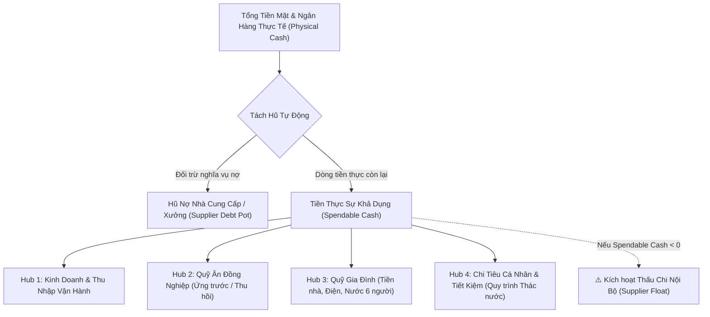
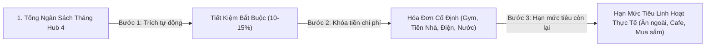
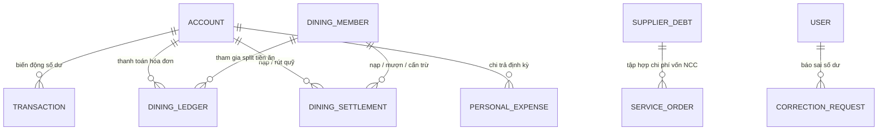

# CFO FLOW — TÀI LIỆU TOÀN DIỆN VỀ KIẾN TRÚC, LOGIC NGHIỆP VỤ & THUẬT TOÁN HỆ THỐNG

> **Phiên bản tài liệu:** 4.0 (Enterprise Architecture, High-Integrity Financial Engine & Concurrency Resilience)  
> **Hệ thống:** CFO Flow (Quản lý dòng tiền, tách bạch 4 Hubs sổ quỹ, công nợ xưởng & tối ưu tài chính cá nhân)  
> **Công nghệ nền tảng:** Node.js, Express.js, MongoDB (Mongoose), Alpine.js, Tailwind CSS, Zod, KaTeX  

---

## MỤC LỤC
1. [TỔNG QUAN HỆ THỐNG & TRIẾT LÝ DÒNG TIỀN](#1-tổng-quan-hệ-thống--triết-lý-dòng-tiền)
2. [MÔ HÌNH DÒNG TIỀN 4 HUBS (4-HUB CASH FLOW FRAMEWORK)](#2-mô-hình-dòng-tiền-4-hubs-4-hub-cash-flow-framework)
3. [THUẬT TOÁN & LOGIC CỐT LÕI (CORE ALGORITHMS)](#3-thuật-toán--logic-cốt-lõi-core-algorithms)
   - [3.1. Thuật toán Tiền Khả Dụng & Cơ Chế Thấu Chi Nội Bộ (Supplier Float)](#31-thuật-toán-tiền-khả-dụng--cơ-chế-thấu-chi-nội-bộ-supplier-float)
   - [3.2. Thuật toán Đồng Hồ Tốc Độ Tuần Theo Múi Giờ Việt Nam (Timezone-Aware Speedometer)](#32-thuật-toán-đồng-hồ-tốc-độ-tuần-theo-múi-giờ-việt-nam-timezone-aware-speedometer)
   - [3.3. Thuật toán Phân Bổ Ngân Sách Dòng Thác Hub 4 (Waterfall Budgeting Engine)](#33-thuật-toán-phân-bổ-ngân-sách-dòng-thác-hub-4-waterfall-budgeting-engine)
   - [3.4. Thuật toán Số Học Số Tiền An Toàn (Safe Monetary Math & Zero Float Precision Loss)](#34-thuật-toán-số-học-số-tiền-an-toàn-safe-monetary-math--zero-float-precision-loss)
   - [3.5. Thuật toán Chia Tiền Hóa Đơn Bữa Ăn & Sinh Hoạt (Equal & Custom Splits)](#35-thuật-toán-chia-tiền-hóa-đơn-bữa-ăn--sinh-hoạt-equal--custom-splits)
   - [3.6. Thuật toán Định Danh Thành Viên & Khử Xung Đột Tên (ObjectId References)](#36-thuật-toán-định-danh-thành-viên--khử-xung-đột-tên-objectid-references)
   - [3.7. Thuật toán Cấn Trừ Đối Soát Liên Quỹ Bảo Đảm ACID (Dual-Fund Reconciliation)](#37-thuật-toán-cấn-trừ-đối-soát-liên-quỹ-bảo-đảm-acid-dual-fund-reconciliation)
   - [3.8. Thuật toán Quản Lý Công Nợ 2 Chiều & Thanh Toán Trả Góp (Partial Payments)](#38-thuật-toán-quản-lý-công-nợ-2-chiều--thanh-toán-trả-góp-partial-payments)
   - [3.9. Thuật toán Hợp Nhất Dòng Tiền Đa Sổ Chống Tràn Bộ Nhớ (Database-Level $unionWith Feed)](#39-thuật-toán-hợp-nhất-dòng-tiền-đa-sổ-chống-tràn-bộ-nhớ-database-level-unionwith-feed)
4. [KIẾN TRÚC TOÀN VẸN DỮ LIỆU & XỬ LÝ ĐỒNG THỜI (CONCURRENCY & INTEGRITY)](#4-kiến-trúc-toàn-vẹn-dữ-liệu--xử-lý-đồng-thời-concurrency--integrity)
   - [4.1. Khử Race Conditions Bằng Toán Tử Nguyên Tử $inc](#41-khử-race-conditions-bằng-toán-tử-nguyên-tử-inc)
   - [4.2. Giao Thức ACID Transactions Đa Tài Liệu](#42-giao-thức-acid-transactions-đa-tài-liệu)
   - [4.3. Lớp Xác Thực Nghiêm Ngặt Bằng Zod Middleware](#43-lớp-xác-thực-nghiêm-ngặt-bằng-zod-middleware)
5. [HỆ THỐNG PHÂN QUYỀN HẠT NHÂN (GRANULAR RBAC - 10 QUYỀN & 7 ROLES)](#5-hệ-thống-phân-quyền-hạt-nhân-granular-rbac---10-quyền--7-roles)
6. [CƠ CẤU DỮ LIỆU & QUAN HỆ THỰC THỂ (DATABASE ERD)](#6-cơ-cấu-dữ-liệu--quan-hệ-thực-thể-database-erd)
7. [NGUYÊN TẮC BẤT DI BẤT DỊCH: BẢO VỆ DỮ LIỆU NGƯỜI DÙNG](#7-nguyên-tắc-bất-di-bất-dịch-bảo-vệ-dữ-liệu-người-dùng)

---

## 1. TỔNG QUAN HỆ THỐNG & TRIẾT LÝ DÒNG TIỀN

Hệ thống **CFO Flow** giải quyết căn nguyên của rủi ro tài chính cá nhân & hộ kinh doanh dịch vụ: **Sự ngộ nhận về số dư thực tế (Cash Illusion)**. Khi tiền bán hàng, tiền vốn nợ xưởng, tiền đóng quỹ ăn uống của đồng nghiệp, chi phí tiền nhà của gia đình và tiền chi tiêu sinh hoạt cùng nằm chung trong các tài khoản ngân hàng, việc nhìn vào tổng số dư tài khoản ngân hàng sẽ dẫn đến chi tiêu quá tay vào các khoản tiền "không thuộc về mình".

Hệ thống thiết lập nguyên tắc vận hành vững chắc:
1. **Phân tách thực tế vật lý và sổ quy ước**: Phản ánh chính xác tài khoản ngân hàng thực tế, đồng thời ánh xạ vào 4 Hubs chức năng riêng biệt.
2. **Bảo vệ Hũ Vốn NCC nhưng không làm tắc nghẽn sinh hoạt**: Áp dụng cơ chế **Thấu chi nội bộ (Supplier Float)**, tự động nhận diện và gắn cờ các khoản chi đang mượn vốn của NCC kèm dải cảnh báo trực quan thay vì chặn cứng hệ thống.
3. **Cân đối kế toán thời gian thực**: Mọi khoản thu chi, chia hóa đơn, nạp tiền, mượn quỹ hay cấn trừ đều được cập nhật nguyên tử, triệt tiêu sai số.



---

## 2. MÔ HÌNH DÒNG TIỀN 4 HUBS (4-HUB CASH FLOW FRAMEWORK)

Mọi tài khoản ngân hàng, ví điện tử hoặc tiền mặt trong CFO Flow đều được gán nhãn thuộc về 1 trong 4 Hubs chức năng:

| Hub | Tên Gọi | Mã Định Danh | Bản Chất Kế Toán | Mục Đích Sử Dụng |
| :--- | :--- | :--- | :--- | :--- |
| **Hub 1** | **Thu Nhập & Kinh Doanh** | `hub1_income` | Dòng tiền vận hành chính | Tiếp nhận doanh thu dịch vụ/bán hàng, thu tiền khách, thanh toán tiền vốn xưởng sản xuất. |
| **Hub 2** | **Quỹ Ăn Nhóm** | `hub2_dining` | Vốn lưu động tạm thời (Ứng trước) | Ứng tiền thanh toán bữa ăn trưa/tối cho nhóm 14 người, theo dõi nạp quỹ, mượn quỹ và bù trừ nợ bữa ăn. |
| **Hub 3** | **Quỹ Gia Đình** | `hub3_family` | Quỹ sinh hoạt chung | Quản lý dòng tiền sinh hoạt của 6 thành viên: tiền thuê nhà, tiền điện, nước, internet, chi tiêu chung. |
| **Hub 4** | **Cá Nhân & Tiết Kiệm** | `hub4_personal` | Dòng tiền tiêu dùng & tích lũy | Trích tiết kiệm tự động 10-15%, thanh toán hóa đơn cá nhân cố định (Gym, Netflix), kiểm soát hạn mức tiêu tuần của 2 người. |

---

## 3. THUẬT TOÁN & LOGIC CỐT LÕI (CORE ALGORITHMS)

### 3.1. Thuật toán Tiền Khả Dụng & Cơ Chế Thấu Chi Nội Bộ (Supplier Float)
* **Ý nghĩa thực tế**: Trong kinh doanh dịch vụ, xưởng sản xuất cho phép thanh toán công nợ gối đầu theo kỳ (cuối tháng hoặc chu kỳ 15 ngày). Nếu chặn cứng (bắn lỗi 400) khi tài khoản âm tiền khả dụng sẽ làm tê liệt việc chi tiêu sinh hoạt thiết yếu hàng ngày.
* **Công thức toán học**:

$$\text{TotalPhysicalCash} = \sum_{i=1}^{n} \text{AccountBalance}_i$$

$$\text{TotalSupplierDebt} = \sum_{j=1}^{m} \text{SupplierRemainingAmount}_j$$

$$\text{SpendableCash} = \text{TotalPhysicalCash} - \text{TotalSupplierDebt}$$

* **Cơ chế Thấu Chi Nội Bộ (Supplier Float)**:
  - Khi một khoản chi tiêu phát sinh ($\text{Amount}$):
    - Nếu $\text{SpendableCash} \ge \text{Amount}$: Giao dịch hợp lệ bình thường, `usingSupplierFloat = false`.
    - Nếu $\text{SpendableCash} < \text{Amount}$: Hệ thống **vẫn cho phép tạo giao dịch** để không gián đoạn sinh hoạt, nhưng tự động đánh dấu cờ dữ liệu:
      $$\text{usingSupplierFloat} = \text{true}$$
  - **Cảnh báo Frontend thời gian thực**: Khi state $\text{SpendableCash} < 0$, giao diện render dải banner nổi bật với nội dung chuẩn hóa:
    > `⚠️ ĐANG DÙNG VỐN CHIẾM DỤNG (NCC): [|SpendableCash|] VNĐ - Hãy lưu ý dòng tiền khi đến hạn thanh toán!`

---

### 3.2. Thuật toán Đồng Hồ Tốc Độ Tuần Theo Múi Giờ Việt Nam (Timezone-Aware Speedometer)
* **Khắc phục lỗi lệch múi giờ (Timezone Skew)**: Máy chủ UTC thường nhóm giao dịch phát sinh lúc 01:00 AM sáng Thứ Hai (giờ Việt Nam, UTC+7) vào ngày Chủ Nhật tuần trước. Hệ thống sử dụng toán tử native `$dateTrunc` và `$dateFromString` với tham số `timezone: "Asia/Ho_Chi_Minh"` để bọc chính xác khung tuần từ Thứ Hai 00:00:00 đến Chủ Nhật 23:59:59.
* **Khấu trừ dòng tiền hoàn vào Hub 4 (Net Weekly Spend)**: Chi tiêu tuần phải phản ánh số tiền đã tiêu ròng, tức là trừ đi các khoản hoàn tiền, bồi hoàn hoặc thu nhập đặc thù quay lại Hub 4 trong tuần đó.
* **Công thức**:

$$\text{GrossWeeklySpent} = \text{MyDiningShareWeekly} + \text{WeeklyPersonalExpenses} + \text{WeeklyPaidDebts}$$

$$\text{NetWeeklySpent} = \max\left(0, \text{GrossWeeklySpent} - \text{Hub4WeeklyRefunds}\right)$$

$$\text{WeeklyPercent} = \text{round}\left( \frac{\text{NetWeeklySpent}}{\text{WeeklyLimit}} \times 100\% \right)$$

* **Cơ chế Phanh 3 Cấp Độ (Speedometer State Machine)**:
  - $\text{WeeklyPercent} < 80\%$: **Vùng Xanh (An toàn)** — Tốc độ tiêu tiền bình thường.
  - $80\% \le \text{WeeklyPercent} < 100\%$: **Vùng Vàng (Cảnh Báo)** — Tốc độ tiêu tiền nhanh, cần tiết giảm ăn ngoài/mua sắm.
  - $\text{WeeklyPercent} \ge 100\%$: **Vùng Đỏ (Phanh Gấp / Brake Active)** — Vượt hạn mức tuần.

---

### 3.3. Thuật toán Phân Bổ Ngân Sách Dòng Thác Hub 4 (Waterfall Budgeting Engine)
Tự động điều phối ngân sách sinh hoạt cho 2 người theo nguyên tắc 3 bước không thể đảo ngược:



$$\text{TargetSavings} = \text{safeMath.percent}(\text{Hub4Budget}, \text{SavingsRate})$$

$$\text{SpendableFlexibleMonthly} = \max\left(0, \text{safeMath.subtract}(\text{safeMath.subtract}(\text{Hub4Budget}, \text{TargetSavings}), \text{TotalFixedBills})\right)$$

---

### 3.4. Thuật toán Số Học Số Tiền An Toàn (Safe Monetary Math & Zero Float Precision Loss)
* **Vấn đề**: JavaScript sử dụng chuẩn IEEE 754 float dẫn đến hiện tượng sai số tích lũy: $0.1 + 0.2 = 0.30000000000000004$. Trong tài chính, sai số này gây lệch số dư ngân hàng và không khớp báo cáo kế toán.
* **Giải pháp kiến trúc ([utils/math.util.js](file:///Users/tracy/Downloads/Download/CF/utils/math.util.js))**:
  - Triển khai số học số nguyên tỷ lệ với hệ số $\text{SCALE} = 100$.
  - Mọi phép tính đều chuyển đổi về số nguyên trước khi thực thi và làm tròn Banker's Rounding:
    ```javascript
    function toInt(value) { return Math.round(Number(value) * SCALE); }
    function fromInt(scaled) { return scaled / SCALE; }
    ```
  - Cung cấp các hàm an toàn: `add`, `subtract`, `multiply`, `divide`, `percent`, `sum`.

---

### 3.5. Thuật toán Chia Tiền Hóa Đơn Bữa Ăn & Sinh Hoạt (Equal & Custom Splits)

#### A. Chế độ Chia Đều (Equal Mode)
* Chia cho $k$ thành viên được tích chọn tham gia.
* Thuật toán bảo toàn tổng tiền (chia chẵn đến hàng trăm đồng, phần dư dồn cho chủ hóa đơn):

$$\text{BaseShare} = \text{floor}\left( \frac{\text{TotalBill}}{k \times 100} \right) \times 100$$

$$\text{Remainder} = \text{TotalBill} - (\text{BaseShare} \times k)$$

$$\text{Share}_{\text{Host}} = \text{BaseShare} + \text{Remainder}, \quad \text{Share}_i = \text{BaseShare} \quad (i = 2 \dots k)$$

Đảm bảo phương trình cân bằng tuyệt đối: $\sum_{i=1}^{k} \text{Share}_i = \text{TotalBill}$.

#### B. Chế độ Chia Tự Chọn (Custom Mode)
* Từng thành viên được nhập số tiền thực tế họ đã gọi món.
* Hệ thống tính $\text{Remaining} = \text{TotalBill} - \sum \text{CustomAmount}_i$. Chỉ cho phép lưu khi $\text{Remaining} = 0$.

---

### 3.6. Thuật toán Định Danh Thành Viên & Khử Xung Đột Tên (ObjectId References)
* **Vấn đề cũ**: Việc chuẩn hóa chuỗi `normalizeKey("Hải")` và `normalizeKey("Hai")` đều ra chuỗi `"hai"`, gây ra hiện tượng cộng gộp số dư nhầm giữa 2 người khác nhau.
* **Kiến trúc mới**:
  - `DiningLedger.splits[].memberId` và `DiningSettlement.memberId` lưu trực tiếp `mongoose.Schema.Types.ObjectId` tham chiếu tới `DiningMember`.
  - Thuật toán tính toán số dư ưu tiên khớp theo `memberId`. Chuỗi `personKey` chỉ đóng vai trò thứ cấp (fallback) cho các bản ghi di sản.
  - Tự động chạy quy trình `backfillMemberIds()` an toàn khi khởi động máy chủ để liên kết các bản ghi cũ mà không làm mất hay thay đổi dữ liệu.

---

### 3.7. Thuật toán Cấn Trừ Đối Soát Liên Quỹ Bảo Đảm ACID (Dual-Fund Reconciliation)
* **Nghiệp vụ**: Một thành viên có số dư dương ở Quỹ Ăn Đồng Nghiệp (Hub 2) và cần nộp tiền vào Quỹ Gia Đình (Hub 3). Hai quỹ thực hiện cấn trừ nội bộ, **không phát sinh chuyển khoản ngân hàng thật**.
* **Bảo toàn giao dịch bằng ACID Transaction**:
  - Sinh mã phiên duy nhất `transferRef`.
  - Mở `mongoose.startSession()` và thực thi `session.withTransaction()`:
    1. Tạo bản ghi xuất quỹ nguồn: `direction = 'out'`, `topupKind = 'transfer_out'`, `accountName = 'Nội bộ (Cấn trừ 2 sổ)'`, `addToAccount = false`.
    2. Tạo bản ghi nhập quỹ đích: `direction = 'in'`, `topupKind = 'transfer_in'`, `accountName = 'Nội bộ (Cấn trừ 2 sổ)'`, `addToAccount = false`.
  - Nếu xảy ra lỗi giữa chừng, toàn bộ 2 vế bị rollback tự động.
  - Khi xóa giao dịch cấn trừ, hệ thống xóa nguyên tử cả 2 vế qua `transferRef`.

---

### 3.8. Thuật toán Quản Lý Công Nợ 2 Chiều & Thanh Toán Trả Góp (Partial Payments)
* **Vấn đề cũ**: Dùng cờ boolean (`customerPaid`, `supplierPaid`) làm mất khả năng theo dõi khi khách trả trước 50% tiền cọc hoặc khi trả góp tiền vốn cho xưởng.
* **Cơ cấu trường số học & Máy trạng thái**:
  - Khách hàng (Doanh thu & Phải thu): `salePrice`, `customerPaidAmount`, `customerRemainingAmount`, `customerPaymentStatus`.
  - Nhà cung cấp (Vốn & Phải trả): `costPrice`, `supplierPaidAmount`, `supplierRemainingAmount`, `supplierPaymentStatus`.
  - Tự động hóa qua Mongoose `pre('save')` hook:
    $$\text{RemainingAmount} = \max\left(0, \text{TotalAmount} - \text{PaidAmount}\right)$$
    $$\text{Status} = \begin{cases} \text{'pending'}, & \text{PaidAmount} = 0 \\ \text{'partial'}, & 0 < \text{PaidAmount} < \text{TotalAmount} \\ \text{'completed'}, & \text{PaidAmount} \ge \text{TotalAmount} \end{cases}$$
  - Hỗ trợ Virtual Getters/Setters để giữ tương thích ngược 100% với các nút bấm chuyển đổi nhanh trên giao diện cũ.

---

### 3.9. Thuật toán Hợp Nhất Dòng Tiền Đa Sổ Chống Tràn Bộ Nhớ (Database-Level $unionWith Feed)
* **Vấn đề OOM**: Đọc toàn bộ dữ liệu từ 4 collection riêng biệt vào RAM Node.js rồi ghép mảng và `Array.sort()` sẽ làm sập ứng dụng (Out-Of-Memory) khi dữ liệu tăng trưởng.
* **Giải pháp MongoDB native pipeline ([services/unifiedFeed.service.js](file:///Users/tracy/Downloads/Download/CF/services/unifiedFeed.service.js))**:
  - Sử dụng toán tử `$unionWith` để gom dữ liệu trực tiếp tại tầng MongoDB storage engine:
    1. Base: `transactions`
    2. Union 1: `diningledgers` (lọc các hóa đơn có trừ tiền ngân hàng `deductFromAccount = true`).
    3. Union 2: `diningsettlements` (lọc các khoản nạp/mượn có biến động tài khoản, bỏ qua cấn trừ nội bộ `transferRef`).
    4. Union 3: `personalexpenses` (lọc các hóa đơn cá nhân Hub 4 đã thanh toán `status = 'paid'`).
  - Phân trang chuẩn xác: Thực hiện `$sort: { date: -1, createdAt: -1 }`, kết hợp `$facet` để trả về danh sách kèm metadata phân trang (`page`, `limit`, `total`, `totalPages`) mà không tốn dung lượng RAM Node.js.

---

## 4. KIẾN TRÚC TOÀN VẸN DỮ LIỆU & XỬ LÝ ĐỒNG THỜI (CONCURRENCY & INTEGRITY)

### 4.1. Khử Race Conditions Bằng Toán Tử Nguyên Tử $inc
Loại bỏ hoàn toàn kiến trúc "Read-Then-Write" (`findOne` $\rightarrow$ `balance += delta` $\rightarrow$ `save()`). Thay thế bằng hàm cập nhật số dư nguyên tử tại tầng CSDL:

```javascript
await Account.findOneAndUpdate(
  filter,
  { $inc: { balance: numDelta } },
  { new: true, runValidators: true, session }
);
```

### 4.2. Giao Thức ACID Transactions Đa Tài Liệu
Mọi luồng thao tác tác động đồng thời lên nhiều collection (như cấn trừ liên quỹ, xóa đồng thời 2 vế đối ứng) đều được bọc trong phiên làm việc có bảo vệ:
```javascript
const session = await mongoose.startSession();
try {
  await session.withTransaction(async () => {
    // Thao tác ghi nhiều collection độc lập
  });
} finally {
  await session.endSession();
}
```

### 4.3. Lớp Xác Thực Nghiêm Ngặt Bằng Zod Middleware
Trước khi dữ liệu chạm vào Controller hoặc Database, middleware [middlewares/validateTransaction.js](file:///Users/tracy/Downloads/Download/CF/middlewares/validateTransaction.js) sẽ kiểm tra:
* `amount`: Bắt buộc là số dương $> 0$ (ngăn chặn tiêm số âm phá hoại số dư).
* `type`: Bắt buộc thuộc enum `['expense', 'income', 'transfer']`.
* `hubRole`: Bắt buộc thuộc 1 trong 4 Hubs cốt lõi (`hub1_income`, `hub2_dining`, `hub3_family`, `hub4_personal`).
* `accountId` / `accountName`: Kiểm tra định dạng hợp lệ.

---

## 5. HỆ THỐNG PHÂN QUYỀN HẠT NHÂN (GRANULAR RBAC - 10 QUYỀN & 7 ROLES)

Hệ thống quản lý truy cập và quyền hạn phân chia độc lập thành 10 quyền nguyên tử:

1. `viewOverview`: Xem Dashboard tổng quan 4 Hubs, chỉ số tài chính và đồng hồ tốc độ.
2. `manageAccounts`: Quản lý tài khoản ngân hàng, ví điện tử, tiền mặt.
3. `manageTransactions`: Ghi sổ, sửa, xóa các giao dịch thu/chi/chuyển khoản tổng quát.
4. `manageDiningWork`: Quản trị Quỹ Ăn Đồng Nghiệp (Hub 2) — chia hóa đơn, ghi nhận nạp/mượn quỹ.
5. `manageDiningFamily`: Quản trị Quỹ Sinh Hoạt Gia Đình (Hub 3) — quản lý tiền nhà, điện nước, cấn trừ liên quỹ.
6. `managePersonalHub`: Quản trị Quỹ Cá Nhân & Tiết Kiệm (Hub 4) — phân bổ dòng thác, theo dõi hóa đơn cố định.
7. `manageDebts`: Quản lý Sổ Nợ Cá Nhân 2 chiều & Hũ Công Nợ Xưởng NCC.
8. `manageUsers`: Phân quyền người dùng, cấp tài khoản, đổi mật khẩu.
9. `manageConfig`: Cấu hình tham số hệ thống: hạn mức tuần, tỷ lệ tiết kiệm, số dư ban đầu.
10. `viewDining`: Quyền dành riêng cho Khách/Thành viên — **Chỉ Xem** sổ ăn và sinh hoạt gia đình, có quyền gửi `CorrectionRequest` (Cờ báo sai).

### Ma Trận Quyền Của 7 Nhóm Vai Trò (Role Presets Matrix):

| Role Preset | viewOverview | manageAccounts | manageTransactions | manageDiningWork | manageDiningFamily | managePersonalHub | manageDebts | manageUsers | manageConfig | viewDining |
| :--- | :---: | :---: | :---: | :---: | :---: | :---: | :---: | :---: | :---: | :---: |
| **Admin** | ✅ | ✅ | ✅ | ✅ | ✅ | ✅ | ✅ | ✅ | ✅ | ❌ |
| **Manager (Quản Lý)** | ✅ | ✅ | ✅ | ✅ | ✅ | ❌ | ✅ | ❌ | ❌ | ❌ |
| **Colleague (Đồng Nghiệp)** | ❌ | ❌ | ❌ | ✅ | ❌ | ❌ | ❌ | ❌ | ❌ | ❌ |
| **Family (Gia Đình)** | ❌ | ❌ | ❌ | ❌ | ✅ | ❌ | ❌ | ❌ | ❌ | ❌ |
| **Partner (Người Yêu)** | ✅ | ❌ | ❌ | ❌ | ✅ | ✅ | ❌ | ❌ | ❌ | ❌ |
| **Guest (Khách Xem)** | ❌ | ❌ | ❌ | ❌ | ❌ | ❌ | ❌ | ❌ | ❌ | ✅ |
| **Viewer (Chỉ Xem Chung)**| ✅ | ❌ | ❌ | ❌ | ❌ | ❌ | ❌ | ❌ | ❌ | ❌ |

---

## 6. CƠ CẤU DỮ LIỆU & QUAN HỆ THỰC THỂ (DATABASE ERD)



### Chi Tiết Các Model Chính:
1. `Account`: Số dư thực tế từng tài khoản (`balance`), tên ngân hàng, loại (`bank`, `wallet`, `cash`), phân loại `hubRole`.
2. `Transaction`: Giao dịch thu/chi/chuyển khoản, cờ `usingSupplierFloat`, cờ `impactsWeeklyLimit`.
3. `DiningMember`: Thành viên sổ quỹ (`work` hoặc `family`), `personKey`, `openingBalance`.
4. `DiningLedger`: Bữa ăn nhóm / tiền nhà, mảng `splits` chứa `memberId` (ObjectId), `splitMode` (`equal`/`custom`).
5. `DiningSettlement`: Lịch sử nạp (`in`), mượn (`out`), cấn trừ (`transfer_in`/`transfer_out`), liên kết `memberId` (ObjectId) và `transferRef`.
6. `PersonalExpense`: Hóa đơn cố định hoặc khoản chi Hub 4, phân loại `fixed_bill`, `flexible_expense`, `savings_deposit`.
7. `SupplierDebt`: Hũ nợ nhà cung cấp/xưởng sản xuất: `totalAmount`, `paidAmount`, `remainingAmount`, `status` (`pending`, `partial`, `completed`).
8. `ServiceOrder`: Đơn hàng khách & vốn xưởng: `salePrice`, `customerPaidAmount`, `customerPaymentStatus`, `costPrice`, `supplierPaidAmount`, `supplierPaymentStatus`.
9. `Debt`: Sổ công nợ 2 chiều (`receivable` / `payable`).
10. `CorrectionRequest`: Phiếu yêu cầu đính chính số dư gửi từ thành viên đến quản trị viên.

---

## 7. NGUYÊN TẮC BẤT DI BẤT DỊCH: BẢO VỆ DỮ LIỆU NGƯỜI DÙNG

1. **Quyền Tối Thượng Của Người Dùng (100% Zero Automated Data Mutation)**:
   - Toàn bộ các thuật toán tính toán, đối soát, phân bổ ngân sách, cảnh báo thấu chi và dòng tiền hợp nhất được thực hiện ở tầng **Logic / Projection / Aggregation**.
   - Tuyệt đối không chạy script ngầm tự ý sửa đổi số liệu, số dư tài khoản ngân hàng hay lịch sử giao dịch trong Database. Mọi thay đổi về dữ liệu tài chính chỉ xảy ra khi có thao tác chủ đích và xác nhận của người dùng.
2. **Miễn Nhiễm Với Lỗi Trình Duyệt (Constraint Immunity)**:
   - Các form nhập tiền tệ đều khai báo thuộc tính `novalidate` và `step="any"` để cho phép nhập số lẻ chính xác đến từng đồng (ví dụ: `4.421.355đ`), triệt tiêu hoàn toàn các thông báo lỗi popup phiền hà của trình duyệt.
3. **Bảo Toàn Lịch Sử Giao Dịch (Audit & Reversal Guarantee)**:
   - Bất kỳ thao tác sửa đổi hay xóa bỏ bản ghi nào đều tự động hoàn tác đúng lượng chênh lệch ngân hàng cũ (`revertDelta`) bằng toán tử `$inc` trước khi áp dụng lượng biến động mới, loại bỏ nguy cơ lệch sổ kép.

