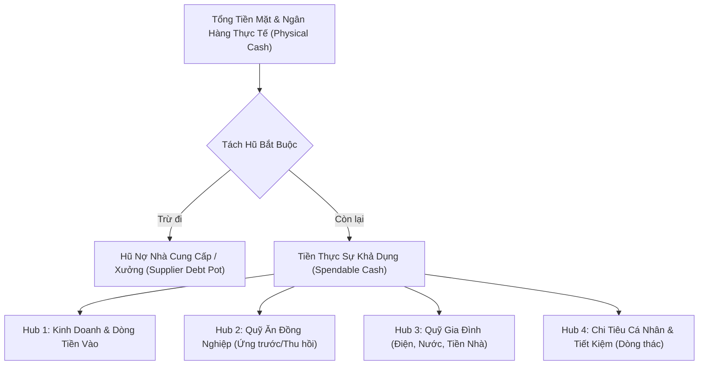
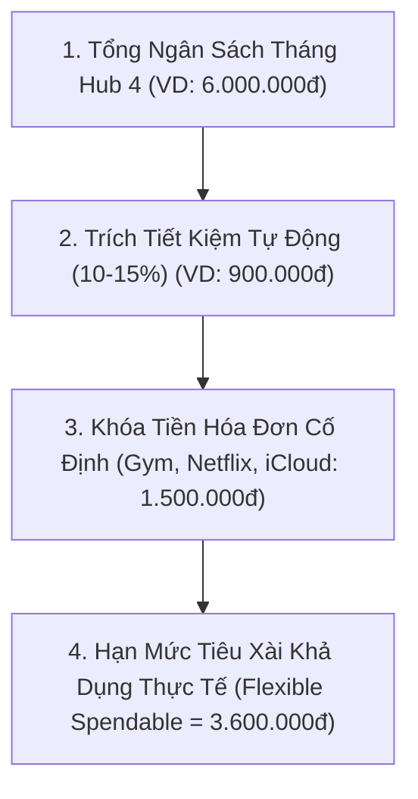
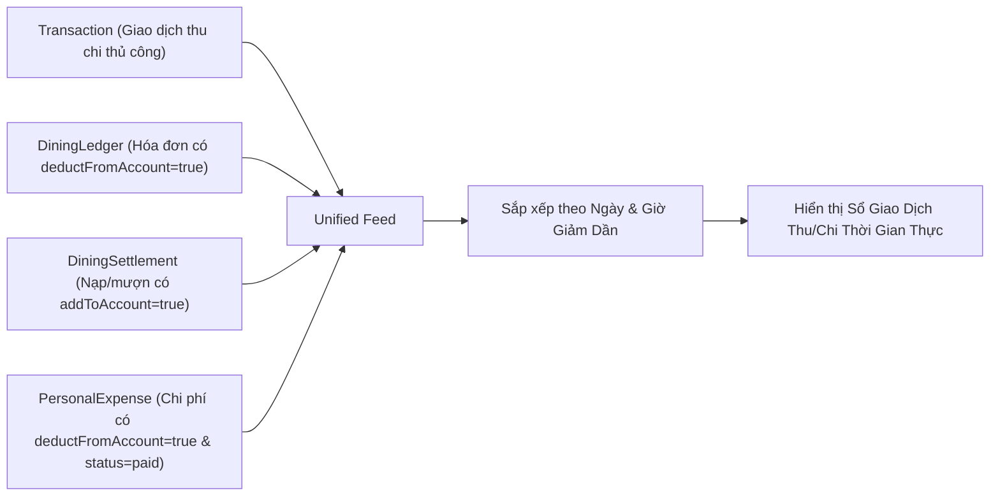
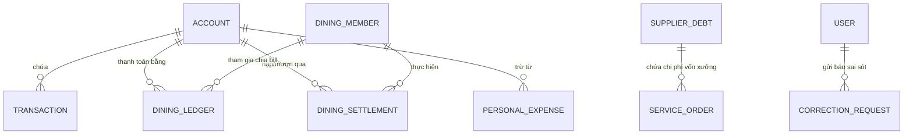

# CFO FLOW — TÀI LIỆU TOÀN DIỆN VỀ KIẾN TRÚC, LOGIC NGHIỆP VỤ & THUẬT TOÁN HỆ THỐNG

> **Phiên bản tài liệu:** 3.4  
> **Hệ thống:** CFO Flow (Quản lý dòng tiền, tách bạch đa sổ quỹ, công nợ & tối ưu tài chính)  
> **Công nghệ nền tảng:** Node.js, Express, MongoDB (Mongoose), Alpine.js, Tailwind CSS  

---

## MỤC LỤC
1. [TỔNG QUAN HỆ THỐNG & TRIẾT LÝ DÒNG TIỀN](#1-tổng-quan-hệ-thống--triết-lý-dòng-tiền)
2. [MÔ HÌNH DÒNG TIỀN 4 HUBS (4-HUB CASH FLOW ARCHITECTURE)](#2-mô-hình-dòng-tiền-4-hubs-4-hub-cash-flow-architecture)
3. [THUẬT TOÁN & LOGIC CỐT LÕI (CORE ALGORITHMS)](#3-thuật-toán--logic-cốt-lõi-core-algorithms)
   - [3.1. Thuật toán Tiền Khả Dụng & Bảo vệ Hũ Hàng](#31-thuật-toán-tiền-khả-dụng--bảo-vệ-hũ-hàng)
   - [3.2. Thuật toán Hạn Mức Tuần & Phanh Dòng Tiền (Weekly Speedometer)](#32-thuật-toán-hạn-mức-tuần--phanh-dòng-tiền-weekly-speedometer)
   - [3.3. Thuật toán Phân Bổ Ngân Sách Dòng Thác (Waterfall Budgeting Hub 4)](#33-thuật-toán-phân-bổ-ngân-sách-dòng-thác-waterfall-budgeting-hub-4)
   - [3.4. Thuật toán Chia Tiền Hóa Đơn (Equal & Custom Splits)](#34-thuật-toán-chia-tiền-hóa-đơn-equal--custom-splits)
   - [3.5. Thuật toán Tính Lũy Kế Số Dư Thành Viên & Chuẩn Hóa Khóa (Multi-key Alias Matching)](#35-thuật-toán-tính-lũy-kế-số-dư-thành-viên--chuẩn-hóa-khóa-multi-key-alias-matching)
   - [3.6. Thuật toán Cấn Trừ Đối Soát 2 Sổ Quỹ (Dual-Fund Reconciliation)](#36-thuật-toán-cấn-trừ-đối-soát-2-sổ-quỹ-dual-fund-reconciliation)
   - [3.7. Thuật toán Đơn Hàng 2 Đầu & Hũ Công Nợ NCC](#37-thuật-toán-đơn-hàng-2-đầu--hũ-công-nợ-ncc)
   - [3.8. Thuật toán Hợp Nhất Dòng Tiền Đa Sổ (Unified Transaction Feed)](#38-thuật-toán-hợp-nhất-dòng-tiền-đa-sổ-unified-transaction-feed)
4. [HỆ THỐNG PHÂN QUYỀN HẠT NHÂN (GRANULAR RBAC - 10 QUYỀN)](#4-hệ-thống-phân-quyền-hạt-nhân-granular-rbac---10-quyền)
5. [CƠ CẤU DỮ LIỆU & QUAN HỆ THỰC THỂ (DATABASE SCHEMA)](#5-cơ-cấu-dữ-liệu--quan-hệ-thực-thể-database-schema)
6. [QUY TRÌNH KIỂM SOÁT LỖI & TOÀN VẸN KẾ TOÁN](#6-quy-trình-kiểm-soát-lỗi--toàn-vẹn-kế-toán)

---

## 1. TỔNG QUAN HỆ THỐNG & TRIẾT LÝ DÒNG TIỀN

CFO Flow được thiết kế dựa trên một vấn đề nhức nhối trong thực tế tài chính: **Lẫn lộn dòng tiền giữa vốn kinh doanh, tiền nợ nhà cung cấp, tiền ứng quỹ ăn nhóm đồng nghiệp, chi phí sinh hoạt gia đình và túi tiền tiêu xài cá nhân.**

Khi mọi khoản tiền đều nằm chung trong tài khoản ngân hàng, bạn rất dễ bị "ảo tưởng số dư" (thấy tài khoản có 50 triệu nhưng thực tế 30 triệu là nợ hàng, 10 triệu là quỹ ứng, bạn chỉ thực có 10 triệu).

Hệ thống giải quyết triệt để vấn đề này bằng:
1. **Cô lập tiền thực (Physical Accounts) và tiền quy ước (Virtual Ledgers).**
2. **Nguyên tắc "Hũ nợ bất khả xâm phạm"**: Tiền nợ xưởng/NCC phải được tự động khóa lại trước khi tính ra tiền bạn được phép tiêu.
3. **Cơ chế đối soát 2 chiều thời gian thực**: Mọi bữa ăn, cấn trừ, nạp tiền đều cân bằng phương trình kế toán.



---

## 2. MÔ HÌNH DÒNG TIỀN 4 HUBS (4-HUB CASH FLOW ARCHITECTURE)

Mọi tài khoản ngân hàng/ví tiền trong hệ thống đều được gán nhãn thuộc về 1 trong 4 Hubs chức năng:

| Hub | Tên Gọi | Bản Chất Kế Toán | Mục Đích Sử Dụng |
| :--- | :--- | :--- | :--- |
| **Hub 1** | **Thu Nhập & Kinh Doanh** (`hub1_income`) | Dòng tiền vận hành chính | Tiếp nhận doanh thu, thanh toán vốn nhập hàng, thu hồi nợ dịch vụ. |
| **Hub 2** | **Quỹ Ăn Nhóm** (`hub2_dining`) | Dòng tiền ứng trước (Vốn lưu động tạm thời) | Ứng tiền trả bill ăn trưa/tối cho nhóm 14 người, thu tiền nạp quỹ, bù trừ nợ bữa ăn. |
| **Hub 3** | **Quỹ Gia Đình** (`hub3_family`) | Quỹ sinh hoạt chung | Quản lý tiền sinh hoạt 6 thành viên: tiền thuê nhà, điện, nước, mua sắm chung. |
| **Hub 4** | **Cá Nhân & Tiết Kiệm** (`hub4_personal`) | Dòng tiền tiêu dùng & tích lũy | Trích tiết kiệm tự động 10-15%, thanh toán hóa đơn cố định (Gym, Netflix), kiểm soát hạn mức tiêu tuần của 2 người. |

---

## 3. THUẬT TOÁN & LOGIC CỐT LÕI (CORE ALGORITHMS)

### 3.1. Thuật toán Tiền Khả Dụng & Bảo vệ Hũ Hàng
* **Mục tiêu**: Ngăn chặn tình trạng tiêu nhầm vào tiền vốn nợ xưởng sản xuất hoặc nhà cung cấp vật tư.
* **Công thức toán học**:

$$\text{TotalPhysicalCash} = \sum_{i=1}^{n} \text{AccountBalance}_i$$

$$\text{TotalSupplierDebt} = \sum_{j=1}^{m} \text{SupplierRemainingAmount}_j$$

$$\text{SpendableCash} = \text{TotalPhysicalCash} - \text{TotalSupplierDebt}$$

* **Logic an toàn**: Nếu $\text{SpendableCash} \le 0$, hệ thống hiển thị cảnh báo mức đỏ nghiêm trọng: Bạn đang bị thâm hụt tiền hàng và dùng tiền của nhà cung cấp để chi trả việc khác.

---

### 3.2. Thuật toán Hạn Mức Tuần & Phanh Dòng Tiền (Weekly Speedometer)
* **Mục tiêu**: Giới hạn tốc độ tiêu tiền trong tuần (mặc định $1.500.000đ/\text{tuần}$) để đảm bảo không bị "cháy túi" vào cuối tháng.
* **Các thành phần tính vào chi tiêu tuần của chủ tài khoản ($Spend_{week}$)**:
  1. $\text{TransactionsWeeklySpent}$: Các giao dịch chi tiêu trong tuần có đánh dấu `impactsWeeklyLimit = true`.
  2. $\text{MyDiningShareWeekly}$: Chỉ tính **phần ăn của chính tôi** ($\text{myShare}$) từ các bữa ăn trong tuần có `deductWeeklyLimit = true` (không tính phần tiền ứng hộ người khác).
  3. $\text{WeeklyPaidDebts}$: Các khoản nợ cá nhân tôi đã trả trong tuần có `impactsWeeklyLimit = true`.

$$\text{CurrentWeekSpent} = \text{TransactionsWeeklySpent} + \text{MyDiningShareWeekly} + \text{WeeklyPaidDebts}$$

$$\text{WeeklyPercent} = \left( \frac{\text{CurrentWeekSpent}}{\text{WeeklyLimit}} \right) \times 100\%$$

* **Cơ chế Phanh 3 Cấp (3-Stage Speed Brake)**:
  - $\text{WeeklyPercent} < 80\%$: **Vùng Xanh (An toàn)** — Tốc độ chi tiêu ổn định.
  - $80\% \le \text{WeeklyPercent} < 100\%$: **Vùng Vàng (Cảnh Báo)** — Cần giảm tốc độ ăn ngoài và mua sắm tùy hứng.
  - $\text{WeeklyPercent} \ge 100\%$: **Vùng Đỏ (Phanh Gấp)** — Hệ thống kích hoạt trạng thái "Khóa Hạn Mức". Mọi khoản chi phát sinh mới trong tuần cần được trì hoãn sang tuần kế tiếp.

---

### 3.3. Thuật toán Phân Bổ Ngân Sách Dòng Thác (Waterfall Budgeting Hub 4)
* **Mục tiêu**: Tự động hóa quy trình quản lý tài chính cho 2 người (tôi và người yêu) theo nguyên tắc: *"Tiết kiệm trước - Chi phí cố định sau - Còn lại mới được tiêu"*.



* **Công thức**:

$$\text{TargetSavings} = \text{round}\left( \text{Hub4Budget} \times \frac{\text{SavingsRate}}{100} \right)$$

$$\text{TotalFixedBills} = \sum \text{PersonalExpense}_{\text{type} = \text{'fixed\_bill'}}$$

$$\text{SpendableFlexibleMonthly} = \max\left(0, \text{Hub4Budget} - \text{TargetSavings} - \text{TotalFixedBills}\right)$$

---

### 3.4. Thuật toán Chia Tiền Hóa Đơn (Equal & Custom Splits)
Khi nhập một hóa đơn (bữa ăn hoặc tiền điện/tiền nhà), hệ thống hỗ trợ 2 chế độ chia tiền:

#### A. Chế độ Chia Đều (Equal Mode)
* Cho phép chọn $k$ người tham gia trong tổng số thành viên.
* **Thuật toán chia chẵn đến hàng trăm đồng**:

$$\text{BaseShare} = \text{floor}\left( \frac{\text{TotalBill}}{k \times 100} \right) \times 100$$

$$\text{Remainder} = \text{TotalBill} - (\text{BaseShare} \times k)$$

* Số tiền chênh lệch lẻ ($\text{Remainder}$) sẽ được cộng dồn vào phần của chủ sổ (hoặc người đầu tiên) để đảm bảo:

$$\sum_{i=1}^{k} \text{SplitAmount}_i = \text{TotalBill} \quad (\text{Chính xác 100\% đến từng đồng})$$

#### B. Chế độ Chia Tự Chọn (Custom Mode)
* Từng thành viên được nhập số tiền tùy ý (do gọi món khác nhau).
* Hệ thống tính toán thời gian thực:

$$\text{AllocatedSum} = \sum \text{CustomAmount}_i$$

$$\text{Remaining} = \text{TotalBill} - \text{AllocatedSum}$$

* Nếu $\text{Remaining} \ne 0$, nút Lưu sẽ hiển thị số tiền lệch và yêu cầu cân bằng trước khi cho phép ghi sổ.

---

### 3.5. Thuật toán Tính Lũy Kế Số Dư Thành Viên & Chuẩn Hóa Khóa (Multi-key Alias Matching)

#### Thách thức:
Tên tiếng Việt có dấu, không dấu, viết hoa, viết thường, hoặc có hậu tố mở ngoặc (ví dụ: `Hải`, `hải`, `hai`, `Thuý (tôi)`, `thuy`, `Bảo (người yêu tôi)`). Nếu so khớp chuỗi thông thường sẽ dẫn đến tình trạng giao dịch nạp tiền một nơi nhưng bảng số dư không nhận diện được.

#### Thuật toán Giải Quyết (Multi-key Alias Engine):
1. **Hàm bóc tách dấu chuẩn Unicode NFD**:

```javascript
function normalizeKey(str) {
  if (!str) return '';
  return str.toLowerCase()
    .normalize('NFD')
    .replace(/[\u0300-\u036f]/g, '')
    .trim()
    .replace(/\s+/g, ' ');
}
```

2. **Cơ chế Đăng Ký Đa Khóa (Alias Set)**:
Mỗi thành viên được tạo một tập hợp các khóa định danh khả dĩ:
- `group_normalizeKey(personKey)` (vd: `family_hai`)
- `group_normalizeKey(personKey.stripParentheses)`
- `group_normalizeKey(name)`
- `group_normalizeKey(name.stripParentheses)`

3. **Phương trình Lũy Kế Số Dư Thành Viên (Ledger Balance Equation)**:

$$\text{CurrentBalance} = \text{OpeningBalance} + \sum \text{TopupAmount} - \sum \text{BorrowedAmount} - \sum \text{EatenAmount}$$

* $\text{CurrentBalance} > 0$: **Còn quỹ** (Thành viên đang gửi tiền trong sổ).
* $\text{CurrentBalance} < 0$: **Đang nợ** (Thành viên đang nợ tiền ăn/tiền quỹ).
* $\text{CurrentBalance} = 0$: **Hòa sổ**.

---

### 3.6. Thuật toán Cấn Trừ Đối Soát 2 Sổ Quỹ (Dual-Fund Reconciliation)

* **Bối cảnh**: Yến có mặt ở cả 2 sổ: Quỹ Ăn Đồng Nghiệp (đang dư $+4.421.355đ$) và Quỹ Gia Đình (cần nộp $+4.421.355đ$ để đóng tiền nhà).
* **Mục tiêu**: Bù trừ trực tiếp giữa 2 sổ, **không chuyển khoản ngân hàng thật** và không làm biến động số dư Vietcombank.
* **Thuật toán sinh giao dịch đối ứng (Atomic Symmetric Ledger Entries)**:
  1. Tạo mã định danh phiên cấn trừ: $\text{transferRef} = \text{`transfer\_` + timestamp + randomKey}$.
  2. Tạo bản ghi xuất quỹ nguồn (Sổ Ăn Nhóm):
     $$\text{Direction} = \text{'out'}, \quad \text{AccountName} = \text{'Nội bộ (Cấn trừ 2 sổ)'}, \quad \text{addToAccount} = \text{false}$$
  3. Tạo bản ghi nhập quỹ đích (Sổ Gia Đình):
     $$\text{Direction} = \text{'in'}, \quad \text{AccountName} = \text{'Nội bộ (Cấn trừ 2 sổ)'}, \quad \text{addToAccount} = \text{false}$$
  4. **Cơ chế Hoàn tác An toàn**: Nếu xóa 1 trong 2 vế cấn trừ, hệ thống dựa vào $\text{transferRef}$ để xóa đồng thời cả 2 vế, đảm bảo không bao giờ bị lệch một bên.

---

### 3.7. Thuật toán Đơn Hàng 2 Đầu & Hũ Công Nợ NCC

* **Mục tiêu**: Theo dõi đơn hàng thời gian thực gồm 2 vế: **Giá thu khách hàng** và **Giá vốn xưởng khắc dấu / NCC**.
* **Công thức tài chính**:

$$\text{GrossProfit} = \text{CustomerPrice} - \text{SupplierCost}$$

$$\text{ProfitMargin} = \left( \frac{\text{GrossProfit}}{\text{CustomerPrice}} \right) \times 100\%$$

* **Theo dõi nợ kép (Dual-State Ledger)**:
  - Khách chưa trả $\rightarrow$ Tăng tổng nợ phải thu khách hàng.
  - Chưa trả xưởng $\rightarrow$ Tự động gộp vào Hũ Nợ Nhà Cung Cấp tương ứng. Khi xưởng có nhiều đơn hàng lẻ, hệ thống gộp tổng tiền nợ xưởng thành 1 dòng duy nhất, bấm vào sẽ bung lịch sử chi tiết từng con dấu/dịch vụ.

---

### 3.8. Thuật toán Hợp Nhất Dòng Tiền Đa Sổ (Unified Transaction Feed)

* **Vấn đề**: Các giao dịch từ Sổ Quỹ Ăn/Gia đình hoặc Sổ Cá Nhân làm biến động tài khoản ngân hàng thực tế nhưng trước đây không hiển thị trong Sổ Giao Dịch, dẫn đến việc lệch số dư ngân hàng không rõ lý do.
* **Thuật toán Hợp Nhất Ảo (Virtual Dynamic Union)**:
  Khi truy vấn Sổ Giao Dịch hoặc Dashboard, backend tự động tổng hợp danh sách từ 4 nguồn mà không làm biến dạng hay nhân đôi dữ liệu:



* **Tránh Nhân Đôi (Deduplication Guard)**:
  - Bỏ qua các giao dịch cấn trừ nội bộ (`transferRef !== null`).
  - Phân loại rõ `source: 'dining_bill'`, `source: 'dining_settlement'`, `source: 'personal_expense'`.
  - Trên giao diện hiển thị nhãn nguồn và nút bấm chuyển nhanh về sổ gốc quản lý.

---

## 4. HỆ THỐNG PHÂN QUYỀN HẠT NHÂN (GRANULAR RBAC - 10 QUYỀN)

Hệ thống triển khai 10 quyền hạn chi tiết độc lập, đi kèm 7 cấu hình mẫu (Role Presets):

### 10 Quyền Hạn Chi Tiết:
1. `viewOverview`: Xem Dashboard tổng quan 4 Hub, biểu đồ và hạn mức tuần.
2. `manageAccounts`: Thêm, sửa, điều chỉnh số dư thực tế các tài khoản ngân hàng / ví MoMo / tiền mặt (Hub 1).
3. `manageTransactions`: Ghi sổ, sửa, xóa các giao dịch thu/chi/chuyển khoản.
4. `manageDiningWork`: Quản lý Sổ Quỹ Ăn Đồng Nghiệp (Hub 2) — chia bill, nạp/mượn quỹ.
5. `manageDiningFamily`: Quản lý Sổ Quỹ Sinh Hoạt Gia Đình (Hub 3) — tiền nhà, điện nước, cấn trừ.
6. `managePersonalHub`: Quản lý Sổ Cá Nhân & Tiết Kiệm (Hub 4) — quỹ 2 người, Gym, Netflix.
7. `manageDebts`: Quản lý Sổ Nợ Cá Nhân 2 Chiều & Hũ Tiền Hàng NCC.
8. `manageUsers`: Quản trị người dùng, tạo tài khoản và phân quyền trực tiếp trên UI.
9. `manageConfig`: Cài đặt hệ thống, thay đổi hạn mức tuần, số dư khởi tạo.
10. `viewDining`: Quyền dành riêng cho Khách/Thành viên — **Chỉ Xem** Quỹ Ăn & Gia Đình, không được sửa, có quyền bấm nút **Cờ Báo Sai** để gửi `CorrectionRequest`.

### 7 Cấu Hình Mẫu (Role Presets Matrix):

| Role Preset | viewOverview | manageAccounts | manageTransactions | manageDiningWork | manageDiningFamily | managePersonalHub | manageDebts | manageUsers | manageConfig | viewDining |
| :--- | :---: | :---: | :---: | :---: | :---: | :---: | :---: | :---: | :---: | :---: |
| **Admin** | ✅ | ✅ | ✅ | ✅ | ✅ | ✅ | ✅ | ✅ | ✅ | ❌ |
| **Manager (Quản Lý)** | ✅ | ✅ | ✅ | ✅ | ✅ | ❌ | ✅ | ❌ | ❌ | ❌ |
| **Colleague (Đồng Nghiệp)** | ❌ | ❌ | ❌ | ✅ | ❌ | ❌ | ❌ | ❌ | ❌ | ❌ |
| **Family (Gia Đình)** | ❌ | ❌ | ❌ | ❌ | ✅ | ❌ | ❌ | ❌ | ❌ | ❌ |
| **Partner (Người Yêu)** | ✅ | ❌ | ❌ | ❌ | ✅ | ✅ | ❌ | ❌ | ❌ | ❌ |
| **Guest (Khách Xem)** | ❌ | ❌ | ❌ | ❌ | ❌ | ❌ | ❌ | ❌ | ❌ | ✅ |
| **Viewer (Chỉ Xem Chung)**| ✅ | ❌ | ❌ | ❌ | ❌ | ❌ | ❌ | ❌ | ❌ | ❌ |

---

## 5. CƠ CẤU DỮ LIỆU & QUAN HỆ THỰC THỂ (DATABASE SCHEMA)



### Các Model Cốt Lõi:
1. `Account`: Lưu trữ số dư thực tế từng ngân hàng, số tài khoản, loại tài khoản (`bank`, `wallet`, `cash`) và `hubRole`.
2. `Transaction`: Giao dịch thu/chi/chuyển khoản tổng quát, tác động hạn mức tuần (`impactsWeeklyLimit`).
3. `DiningLedger`: Hóa đơn ăn nhóm / chi tiêu gia đình, mảng `splits` chứa chi tiết từng người ăn, `splitMode` (`equal`/`custom`).
4. `DiningMember`: Danh sách thành viên từng sổ quỹ (`work` hoặc `family`), số dư đầu kỳ `openingBalance`, khóa định danh `personKey`.
5. `DiningSettlement`: Lịch sử nạp tiền (`in`), mượn quỹ (`out`), cấn trừ (`transfer_in`/`transfer_out`), liên kết tài khoản ngân hàng `addToAccount`.
6. `PersonalExpense`: Chi phí cá nhân Hub 4, phân loại `fixed_bill`, `flexible_expense`, `savings_deposit`, trạng thái `pending`/`paid`.
7. `SupplierDebt`: Hũ tiền hàng nợ xưởng sản xuất, số tiền nợ tích lũy `remainingAmount`.
8. `ServiceOrder`: Đơn hàng khách mua và tiền vốn xưởng, trạng thái thu khách `customerPaid` và trả xưởng `supplierPaid`.
9. `Debt`: Sổ nợ cá nhân 2 chiều (`receivable`: bạn nợ tôi, `payable`: tôi nợ bạn).
10. `CorrectionRequest`: Yêu cầu báo sai số dư hoặc bữa ăn gửi từ thành viên/khách đến người quản lý sổ.
11. `User`: Tài khoản người dùng, mật khẩu băm bcrypt, role và cấu hình 10 quyền chi tiết.
12. `Config`: Cấu hình tham số tài chính: hạn mức tuần, ngân sách Hub 4, tỷ lệ tiết kiệm.

---

## 6. QUY TRÌNH KIỂM SOÁT LỖI & TOÀN VẸN KẾ TOÁN

1. **Nguyên tắc Bảo Toàn Số Dư (Balance Preservation)**:
   - Khi chỉnh sửa hoặc xóa bất kỳ hóa đơn hay giao dịch nạp tiền nào, hệ thống luôn thực hiện quy trình 2 bước:
     - **Bước 1**: Hoàn tác đúng số tiền cũ (`revertDelta`) về tài khoản ngân hàng liên quan.
     - **Bước 2**: Áp dụng số tiền mới (nếu là cập nhật).
2. **Quy tắc Kiểm tra Ràng Buộc HTML5 (Constraint Validation Immunity)**:
   - Tất cả các form modal đều kích hoạt thuộc tính `novalidate` và các ô nhập tiền sử dụng `step="any"` để cho phép nhập số lẻ chính xác đến từng đồng (vd: `4.421.355đ`), triệt tiêu các popup phiền toái mặc định của trình duyệt.
3. **Phân Định Trách Nhiệm Dữ Liệu (Zero Code Mutation)**:
   - Các thuật toán tính toán và báo cáo đều được thiết kế ở tầng Logic / Projection. Không tự ý chạy script ngầm sửa đổi số dư tài khoản hay sổ nợ trong database; toàn bộ quyền quyết định số liệu thuộc về thao tác có chủ đích của người dùng.
